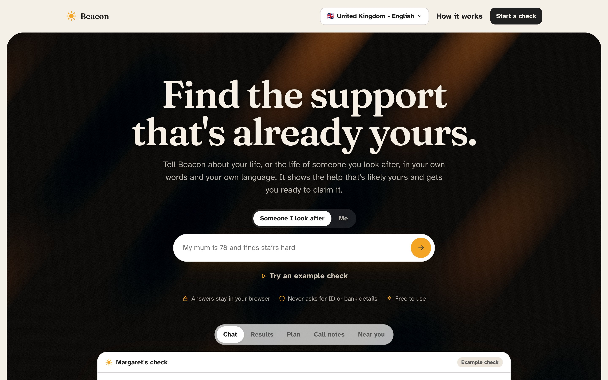
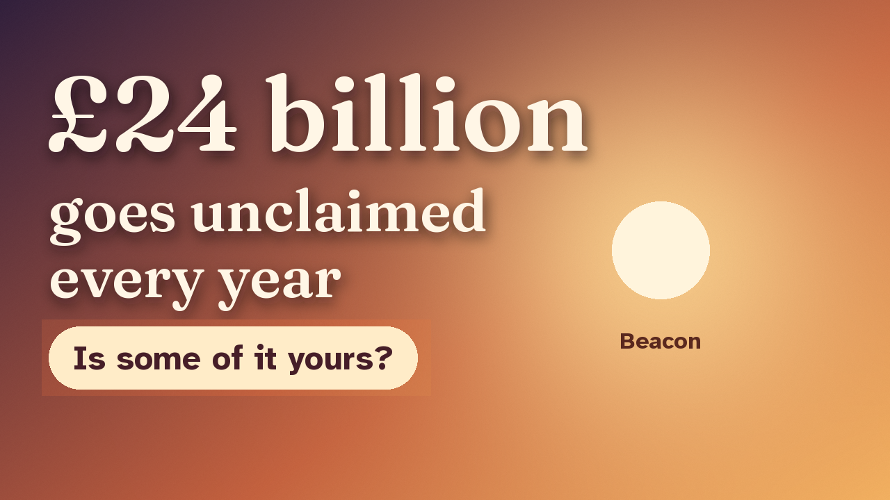
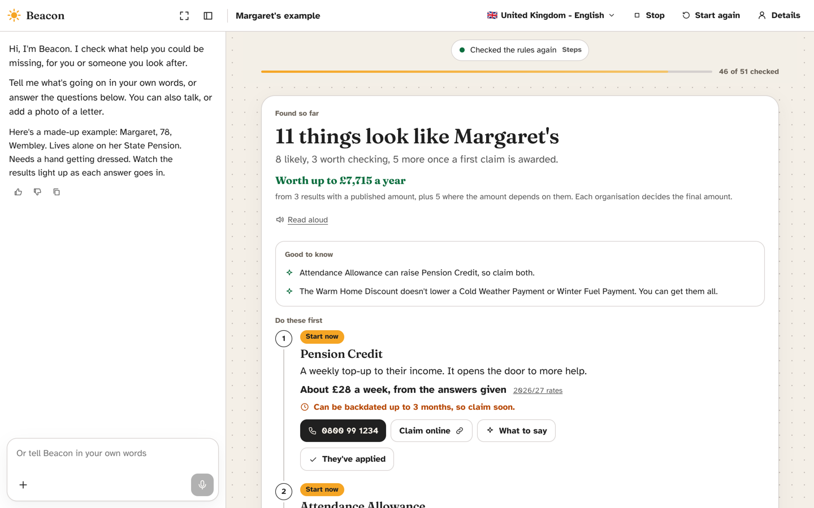
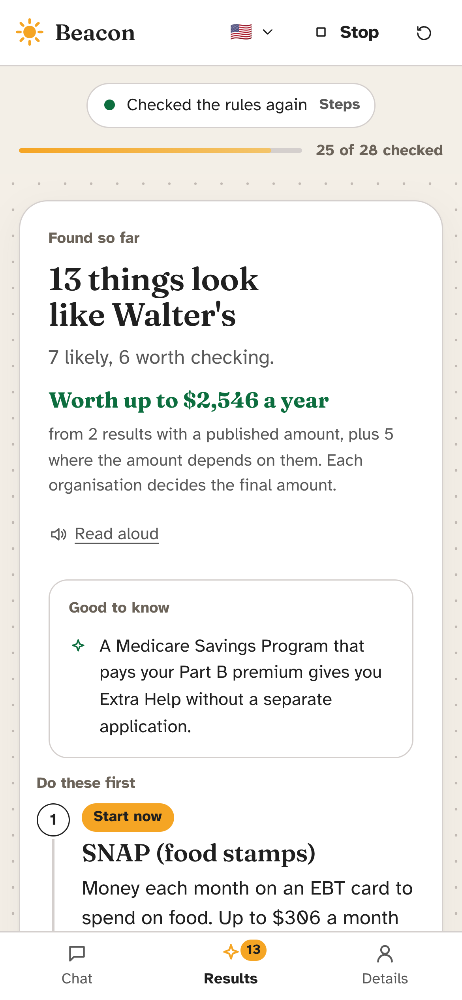
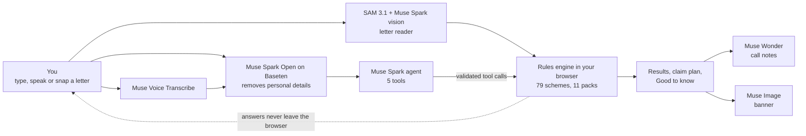

<p align="center">
  
</p>

<h1 align="center">Beacon</h1>

<p align="center">
  <b>Find the support that's already yours.</b>
</p>

<p align="center">
  <a href="https://beacon-support.vercel.app"><b>Open Beacon</b></a> ·
  <a href="https://beacon-support.vercel.app/check#example=margaret">Watch Margaret's check</a> ·
  <a href="https://beacon-support.vercel.app/how">How it works</a> ·
  <a href="#under-the-hood">Under the hood</a>
</p>

<p align="center">
  <sub>Meta Global AI Developer Hackathon 2026 · Indie developer track · <i>Build for Your World</i><br>
  Muse Spark · Muse Wonder · Muse Image · Muse Voice Transcribe · SAM 3.1 · Muse Spark Open on Baseten</sub>
</p>

<p align="center">
  <a href="https://beacon-support.vercel.app"></a>
  <a href="https://youtu.be/hBQzm3mHWHY"></a>
  
  
  
  
  <a href="LICENSE"></a>
</p>



## Watch the 3-minute demo

<p align="center">
  <a href="https://youtu.be/hBQzm3mHWHY"></a>
</p>

<p align="center"><sub>A daughter checks for her mum, a confusing letter gets read, Walter in Ohio finds his help, and you see the six Meta models doing their jobs. <a href="https://x.com/_dineshsunny/status/2118151441051226599">Share it on X</a> if you know someone it could help.</sub></p>

## The help is there. People just never hear about it.

Margaret is 78. She lives alone in Wembley on her State Pension, and getting dressed has become hard. She's never claimed anything, because she assumed it wasn't for people like her.

She's wrong. Run her life through Beacon and **11 kinds of help** light up, worth **up to £7,715 a year**, starting with Pension Credit, which then opens the door to more.

*Margaret is made up. The money isn't.*

- **£24.1bn** of benefits and social tariffs goes unclaimed in Great Britain every year, across more than 7 million households ([Policy in Practice, Missing Out 2025](https://policyinpractice.co.uk/publication/missing-out-2025)).
- **About 1 in 5** people who could get the US Earned Income Tax Credit never claim it ([IRS Taxpayer Advocate Service](https://www.taxpayeradvocate.irs.gov/news/nta-blog/eitc-awareness-day-is-january-23/2026/01)).

That's rent paid on time, a warm flat in January, a carer who gets a break. The people who miss out most have the least time and energy to look: older people living alone, carers, new parents, people who've just lost someone, people reading forms in their second language.

The rules are written for lawyers. Advice lines have queues. Asking feels like admitting you're struggling. So the money stays where it is.

## Beacon is the friend who has read every rule

You don't fill in a form. You just talk.

> *"My dad is 74, lives alone in Columbus and his Medicare costs keep going up."*

Beacon asks a few gentle questions, only the ones that can still change an answer. While you talk, the results light up beside you: what's likely yours, what it's worth, the official rule each answer rests on, and what to do first.

<table>
  <tr>
    <td width="68%"></td>
    <td width="32%"></td>
  </tr>
  <tr>
    <td><sub>You talk on the left. Your results light up on the right, in the order to claim them.</sub></td>
    <td><sub>Walter in Ohio: 13 things, from SNAP to Medicare Savings, on a phone.</sub></td>
  </tr>
</table>

### Built for the moments that are hardest

- **For someone you love.** Say "check for Mum" and the whole check turns to her: her age, her rules, her help.
- **In your own language.** English, Welsh, Polish, Spanish, Bengali, Urdu and Arabic, including right to left. Beacon replies in the language you choose.
- **Out loud.** Press the microphone and say it. Results can be read back to you.
- **With that scary letter.** Snap a photo of a council or benefits letter. Beacon outlines exactly what it read, explains it in two plain sentences and picks out any deadline.
- **Ready for the phone call.** For every result: the number to ring, what to say, what to have ready and what they may ask you.
- **With help near you.** Your own council's pages, local charity grants, community health centres and housing counsellors, matched to your postcode or ZIP code.
- **However you read best.** Eight comfort presets (easier to read, clearer colours, bigger and bolder, listen to it, calmer, fewer distractions, simple words, easier to tap) change the whole app in one tap.
- **After you apply, too.** Mark a claim as applied, awarded or refused. An award opens up the help it unlocks, and a refusal shows you how to challenge it.

### And it keeps your life private

- **Beacon never asks** for your name, address, ID number, bank details or exact date of birth. Month and year are enough.
- **Your answers stay in your browser.** Nothing about you is stored on a server. Even a shared check carries its answers in the part of the link browsers never send.
- **Personal details are removed before any hosted model sees them,** by one of Meta's open-weights models. The chat tells you when it happens.

## Try it in 60 seconds

1. Open **[beacon-support.vercel.app](https://beacon-support.vercel.app)**. Beacon picks the UK or the US from your browser's language. Switch at any time.
2. Type one sentence about someone, or press the microphone and say it.
3. Answer a couple of questions and watch the results light up.
4. Open **What to say** on any result for call notes written by Muse Wonder.
5. Press **+** in the chat and try the sample letter.
6. In a hurry? Press **Example**. Margaret (UK) or Walter (US) answers everything for you.

---

## Under the hood

Everything above runs on Meta's models, and on one firm rule: **models listen, read and explain, and plain code makes every decision.** The same answers always give the same result, and nothing a model says reaches a person until code has checked it.

### Seven jobs for Meta's models

| Model | What it does for the person | Code |
| --- | --- | --- |
| **Muse Spark 1.3**, tool calling | Holds the conversation. It never edits the check itself: it calls five tools (`set_who`, `save_details`, `check_results`, `explain_scheme`, `plan_claims`), code validates every argument against one schema, and each step streams to the chat as it happens. | [`agent.ts`](apps/meta/src/server/agent.ts) |
| **Muse Spark 1.3**, vision and structured output | Reads the letter into a fixed form. It's quarantined: it can't call tools or act, text in the photo is treated as data, and code scrubs ID numbers, account numbers and emails on the way out. | [`letter.ts`](apps/meta/src/server/letter.ts) |
| **SAM 3.1** | Outlines the letter in the photo, so you see exactly what was read. | [`meta.ts`](apps/meta/src/server/meta.ts) |
| **Muse Wonder** | Writes the call notes people rely on most, from that scheme's own rules. If Wonder isn't available, it falls back to Muse Spark. | [`prepare.ts`](apps/meta/src/server/prepare.ts) |
| **Muse Voice Transcribe** | Turns speech into text. The browser records 16 kHz mono WAV itself, so audio is never converted on a server. | [`wav.ts`](apps/meta/src/lib/wav.ts) |
| **Muse Image** | Paints a warm results banner of a UK or US home, from areas of life only (never answers). It's cached per mix, so it's free after the first person. | [`card`](apps/meta/src/app/api/card/route.ts) |
| **Muse Spark Open** (open weights, on Baseten) | Removes names, addresses, phone numbers and ID numbers before anything reaches a hosted model. Code checks again afterwards, so nothing personal leaves even if the host is down. Any OpenAI-compatible host (vLLM on Modal, Muse Glimmer on Fireworks) plugs in through settings. | [`private.ts`](apps/meta/src/server/private.ts) |



### The hard parts

<details open>
<summary><b>Deciding fairly</b>: the rules engine, planner and claim chains</summary>

1. **A rules engine that runs in your browser.** 79 schemes (51 UK, 28 US) live in 11 versioned JSON rule packs, validated by zod on load. Every line, amount and date carries its official source link. `evaluate` settles each scheme as Likely, Worth checking, Unlocks next, Already getting or Ruled out. [`rules.ts`](apps/meta/src/engine/rules.ts), [`pack.ts`](apps/meta/src/engine/pack.ts), [`packs/`](apps/meta/packs)
2. **Derived facts, so people answer less.** From a month and year, Beacon works out age, State Pension age (including the rise from 66 to 67) and Medicare age. From an amount and "a week, a month or a year", it works out weekly and yearly income and compares them with 2026 HHS poverty guidelines for the household size. `derive` in [`rules.ts`](apps/meta/src/engine/rules.ts)
3. **Near misses never hide everything else.** Being just over one line only softens that one condition to Worth checking. The other schemes keep their own verdicts.
4. **A question planner that asks less.** After every answer, it picks the next question that can still change a result and skips the ones that can't, each with its reason. `plan` in [`rules.ts`](apps/meta/src/engine/rules.ts)
5. **Claim chains.** Some help opens the door to more: Pension Credit opens Housing Benefit, Council Tax Reduction and the Warm Home Discount. Beacon orders the claim plan so door-openers come first, marks what each one unlocks, and turns "Unlocks next" into "Likely" the moment an award is recorded. [`claims.tsx`](apps/meta/src/lib/claims.tsx), `claimOrder` in [`rules.ts`](apps/meta/src/engine/rules.ts)
6. **Clash warnings, and reassurance.** "Good to know" notes warn when one claim can lower another, and also say when two don't clash, so people claim both. `warnings` in [`rules.ts`](apps/meta/src/engine/rules.ts)
7. **What it's worth, honestly.** Totals add up only results with a published amount (2026/27 rates). Everything else is labelled "depends on you". Pension Credit is worked out from the answers given.
</details>

<details open>
<summary><b>Talking safely</b>: the agent, privacy layers and letter reader</summary>

8. **An agent that can't break the rules.** Every tool call is parsed against one answers schema ([`answers-schema.ts`](apps/meta/src/engine/answers-schema.ts)) before the engine sees it. A ZIP code moves the check onto US rules and a postcode onto UK rules, mid-conversation.
9. **Two privacy layers before any hosted model.** Open weights rewrite the message, then code patterns catch UK National Insurance numbers, US Social Security numbers, card and account numbers, sort codes, phones and emails. Hosts are tried in order with a time limit, so a slow host never holds up a check. [`private.ts`](apps/meta/src/server/private.ts)
10. **A quarantined letter reader.** SAM 3.1 and Muse Spark run in parallel. SAM's one-phrase prompts are tried in order ("paper", "document", "sheet of paper", "letter"), because "letter" alone finds nothing. [`letter.ts`](apps/meta/src/server/letter.ts)
11. **Live agent steps.** The chat streams newline-delimited JSON events ("Personal details removed", "Checking for Mum", "Saved 3 details. 5 look likely so far") as the agent works. [`api/chat`](apps/meta/src/app/api/chat/route.ts)
12. **Share without storing.** Answers are compressed with the browser's own `CompressionStream` and put in the link's `#fragment`, which browsers never send to a server. Opening a link validates everything against the schema first. [`share.ts`](apps/meta/src/lib/share.ts)
</details>

<details>
<summary><b>Knowing the world</b>: real local data and rules that stay current</summary>

13. **Real help near you, at scale.** Connectors pull open data once, keep it filtered and gzipped, and serve a slice by postcode or ZIP code:
    - 7,165 council service pages (GOV.UK Local Links Manager)
    - 12,231 grant-giving charities (Charity Commission register)
    - 13,275 US community health centres (HRSA)
    - 3,774 housing agencies and 1,286 housing counsellors (HUD)

    [`connectors/`](apps/meta/src/knowledge/connectors)
14. **Place from one field.** A postcode gives nation and council (postcodes.io, with a border check that re-runs the rules if the nation changes). A ZIP code gives state and county.
15. **A knowledge pipeline.** It harvests GOV.UK and stores each page once (1,279 pages). Muse Spark tags the pages of help (300 so far) and drafts new schemes, which must pass the live schema before a person reviews them. [`knowledge/`](apps/meta/src/knowledge)
16. **Rules that notice when the law changes.** A daily GitHub Action re-reads the official page behind every rule and opens a pull request when one changes. A weekly job harvests new pages. [`.github/workflows/`](.github/workflows)
</details>

<details>
<summary><b>Meeting people where they are</b>: countries, languages, access</summary>

17. **Two countries, one engine.** The country comes from the browser's languages, never from location. Currency, amounts, examples, wording, questions and even the banner follow it. [`country.ts`](apps/meta/src/lib/country.ts)
18. **Seven languages.** About 850 message keys each, checked for parity and ICU syntax by [`check-messages.ts`](apps/meta/scripts/check-messages.ts). Arabic and Urdu lay out right to left.
19. **Comfort presets.** Twelve display settings, grouped into eight presets by need, applied as data attributes on `<html>` so plain CSS adapts every page. Your own system settings (zoom, forced colours, reduced motion) always win. [`display.ts`](apps/meta/src/lib/display.ts)
20. **Accessible by default.** Keyboard-first dialogs (a combobox with `aria-activedescendant`), live regions for results, visible focus, large tap targets on phones, and layouts checked at 360, 390, 768 and 1280 pixels wide.
</details>

<details>
<summary><b>Craft and care</b>: the hero, the demo window, running it for real</summary>

21. **A hero light with no library.** One full-screen triangle and a WebGL2 fragment shader draw beacon-amber light that opens from the middle and rolls slowly. It pauses off screen, shows one still frame for reduced motion, and falls back to CSS. [`HeroBeams.tsx`](apps/meta/src/components/marketing/HeroBeams.tsx)
22. **A product window built from the live rules.** The home page's tabbed preview (chat, results, plan, call notes, near you) reads names, amounts, rule lines and phone numbers straight from the rule packs, so it never drifts from what the app really says. [`HeroWindow.tsx`](apps/meta/src/components/marketing/HeroWindow.tsx)
23. **Built to survive a public demo.** A per-IP rate limit, a daily cap and same-origin checks on every model route ([`guard.ts`](apps/meta/src/server/guard.ts)). In-flight requests are de-duplicated and answers cached ([`cache.ts`](apps/meta/src/server/cache.ts)), with prompt-cache keys on long fixed prompts.
24. **Measured without watching anyone.** Cost logs record model, tokens and milliseconds, never words. Vercel Web Analytics and Speed Insights see page paths only, never the answers in a link.
</details>

## What comes next

Today the free check helps people and families in the UK and the US. From one family to a worldwide network:

- **Pro keeps watching after you claim:** the decision, the first payment, changes to report and new rules.
- **Funded Pro.** Councils, housing associations and employers can pay for Pro for the people they serve.
- **Businesses and organisations** find the support they can claim, the same way.
- **More countries.** Each new country brings its own official rules, as a rule pack with a source link on every line.
- **A worldwide network** where providers refer people to each other through Beacon.

Beacon will never take a cut of anything you're awarded.

## Built during the hackathon

Everything in [`apps/meta`](apps/meta) was built for this hackathon, between 27 October and 4 November 2026. This repository was created on 30 October 2026. [`apps/web`](apps/web) and [`packages/`](packages) hold an earlier, separate entry (Beacon on Reflection's Beam model, described in [`docs/beam/README.md`](docs/beam/README.md)). The Meta app doesn't import or depend on them. The full list is in [`apps/meta/README.md`](apps/meta/README.md#built-during-the-hackathon).

## Run it yourself

You need Node 22 or newer and pnpm (`corepack enable`).

```bash
git clone https://github.com/Dinesh-Sunny/beacon.git && cd beacon
pnpm install
cp apps/meta/.env.example apps/meta/.env.local   # add MODEL_API_KEY from https://dev.meta.ai
pnpm --filter meta dev                            # http://localhost:3100
```

`BASETEN_API_KEY` turns on the open-weights privacy step. Without any keys, the questions, rules, results, examples and local help still work. The chat, voice, letter reader, call notes and banner each say calmly that they're off.

<details>
<summary>Repository map</summary>

```
apps/meta/                 The Meta hackathon app (Next.js 16, React 19, TypeScript)
  packs/                   11 rule packs as data: every line, amount and date with its source link
  src/engine/              Rules engine, question planner, answers schema
  src/server/              Meta model client, agent, letter reader, call coach, privacy step, guard
  src/knowledge/           Harvest, triage and draft pipeline, open-data connectors
  src/components/          Chat, check, results, details, place and display, marketing
  src/i18n/                Seven languages
  catalog/                 What Beacon covers, and the stored source pages
docs/                      Images, architecture notes, the earlier Beam entry
.github/workflows/         Daily rule watch, weekly harvest
```
</details>

## Limits

- **Beacon isn't advice.** The organisation that runs each scheme decides, and every result links to its official page.
- Income lines are screening estimates, not the official calculation.
- Council and state schemes vary, so Beacon links to your own council or state office rather than guessing local rules.
- Translations other than English were drafted with help and checked for completeness, but not yet by native speakers.

<p align="center">
  <br>
  <b>Somewhere tonight, someone is going without help that's already theirs.</b><br>
  Beacon is for them.<br><br>
  <a href="https://beacon-support.vercel.app"><b>Open Beacon</b></a> · <a href="LICENSE">Apache 2.0</a>
</p>
