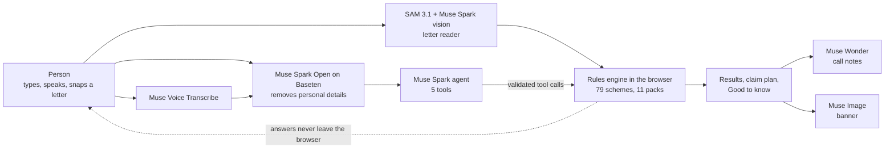
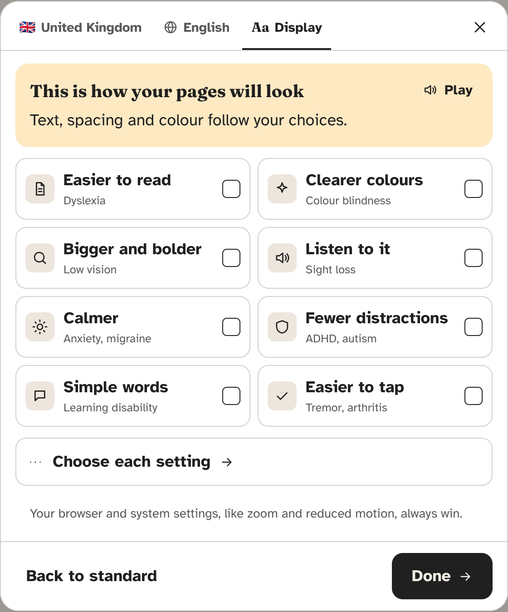

<p align="center">
  
</p>

<h1 align="center">Beacon</h1>

<p align="center">
  <b>Find the support that's already yours.</b><br>
  Tell Beacon about your life, or the life of someone you look after, in your own words and your own language.<br>
  It shows the help that's likely yours, with the official rule behind every answer, and gets you ready to claim it.
</p>

<p align="center">
  <a href="https://beacon-support.vercel.app"><b>Open the live app</b></a> ·
  <a href="https://beacon-support.vercel.app/check#example=margaret">Watch a 60-second example check</a> ·
  <a href="https://beacon-support.vercel.app/how">How it works</a> ·
  <a href="apps/meta/README.md">Run it yourself</a>
</p>

<p align="center">
  Built for the <b>Meta Global AI Developer Hackathon 2026</b> · Startup track · Problem statement: <i>Build for Your World</i><br>
  Muse Spark · Muse Wonder · Muse Image · Muse Voice Transcribe · SAM 3.1 · Muse Spark Open (open weights, on Baseten)
</p>


## Why this exists

Every year, billions in support goes to nobody.

- **£24.1bn** of income-related benefits and social tariffs goes unclaimed in Great Britain in 2025/26, across more than 7 million households ([Policy in Practice, Missing Out 2025](https://policyinpractice.co.uk/publication/missing-out-2025)).
- **About 1 in 5** people who could get the US Earned Income Tax Credit don't claim it ([IRS Taxpayer Advocate Service](https://www.taxpayeradvocate.irs.gov/news/nta-blog/eitc-awareness-day-is-january-23/2026/01)).

People miss out for three reasons: they don't know the help exists, the rules are written for lawyers, and asking feels awkward. The people who miss out most are the ones with the least time to research it: older people, carers, new parents and people who've just lost someone.

Beacon is the friend who has read every rule. You talk to it the way you'd talk to a person ("my dad is 74, lives alone and his Medicare costs keep going up"). It asks only the questions that can still change an answer. It never asks for a name, an ID number or bank details. And it tells you what's likely yours, why, what it's worth, and exactly what to say when you call.

## Try it in 60 seconds

1. Open **[beacon-support.vercel.app](https://beacon-support.vercel.app)**. Beacon picks the UK or the US from your browser's language settings. Change it at any time with the country button.
2. Type one sentence about someone, for example *"My mum is 78, lives alone in Wembley HA9 and finds washing hard"*, or press the microphone and say it.
3. Watch the chat ask a few short questions while the results light up on the right.
4. Open **What to say** on any result to get call notes written by Muse Wonder.
5. Press **+** in the chat and try the sample letter. SAM 3.1 outlines the page and Muse Spark reads it.
6. Short on time? Press **Example** in the top bar. Margaret (UK) or Walter (US) answers every question for you.

<table>
  <tr>
    <td width="68%"></td>
    <td width="32%"></td>
  </tr>
  <tr>
    <td><sub>UK check: the chat on the left, results that light up on the right, with a claim plan, real amounts and "Good to know" notes.</sub></td>
    <td><sub>US check on a phone: the same rules engine, on US rules, in dollars.</sub></td>
  </tr>
</table>

## How Beacon uses Meta's models

Each model has one job. **Plain code makes every decision**, so the same answers always give the same result, and nothing a model says reaches the person until code has checked it.

| Model | Job in Beacon | Code |
| --- | --- | --- |
| **Muse Spark 1.3** (tool calling) | The agent in the chat. It never edits the check directly: it calls five tools (`set_who`, `save_details`, `check_results`, `explain_scheme`, `plan_claims`), and code validates every argument with zod before the rules run. Steps stream to the chat as they happen. | [`server/agent.ts`](apps/meta/src/server/agent.ts) |
| **Muse Spark 1.3** (vision + structured output) | The letter reader. It reads a photo of a council or benefits letter into a fixed JSON schema. It is quarantined: it can't call tools or take any action, the text in the photo is treated as data, and code strips anything shaped like an ID number, account number or email on the way out. | [`server/letter.ts`](apps/meta/src/server/letter.ts) |
| **SAM 3.1** | Finds the letter in the photo and outlines it, so the person sees exactly what was read. | [`server/meta.ts`](apps/meta/src/server/meta.ts) |
| **Muse Wonder** | The call coach: what to say, what to have ready and what they may ask, for one scheme, built from that scheme's rules. Falls back to Muse Spark if Wonder is unavailable. | [`server/prepare.ts`](apps/meta/src/server/prepare.ts) |
| **Muse Voice Transcribe** | Speech to text. The browser records 16 kHz mono WAV itself, so audio is never converted on a server. | [`lib/wav.ts`](apps/meta/src/lib/wav.ts) |
| **Muse Image** | Paints a warm banner for the results, of a UK or US home. The prompt carries areas of life only ("food", "health"), never answers. One banner per mix, cached, so it costs nothing after the first person. | [`api/card`](apps/meta/src/app/api/card/route.ts) |
| **Muse Spark Open** (open weights, on Baseten) | The privacy step. Every message is rewritten without names, street addresses, phone numbers, emails or ID numbers **before** it reaches any hosted model, and the chat says so. Code runs the same rules again on the output, so nothing personal leaves even if the host is down. Any OpenAI-compatible host (vLLM on Modal, a Muse Glimmer deployment on Fireworks) plugs in through settings. | [`server/private.ts`](apps/meta/src/server/private.ts) |



## What makes it hard

The parts of Beacon that took the most engineering, and where to find them.

1. **A rules engine that runs in the browser.** 79 schemes (51 UK, 28 US) in 11 versioned JSON rule packs, validated by zod on load. `evaluate` settles every scheme as Likely, Worth checking, Unlocks next, Already getting or Ruled out. `derive` works out ages, State Pension age, weekly income and the 2026 HHS poverty line. A near miss only softens its own condition, so being £3 over one line never hides everything else. [`engine/rules.ts`](apps/meta/src/engine/rules.ts), [`engine/pack.ts`](apps/meta/src/engine/pack.ts), [`packs/`](apps/meta/packs)
2. **A question planner that asks less.** After every answer it picks the next question that can still change a result, and skips any question that can't change anything, so a person only answers what matters for them. `plan` in [`engine/rules.ts`](apps/meta/src/engine/rules.ts)
3. **Claim chains and clashes.** Some help opens the door to more (Pension Credit opens Housing Benefit, Council Tax Reduction and the Warm Home Discount). Beacon orders claims so the door-openers come first. It warns when one claim can lower another, and says when two don't clash at all. When the person records an award, the help it unlocks moves from "Unlocks next" to "Likely". [`lib/claims.tsx`](apps/meta/src/lib/claims.tsx), `claimOrder` and `warnings` in [`engine/rules.ts`](apps/meta/src/engine/rules.ts)
4. **A tool-calling agent that can't break the rules.** Muse Spark talks, code decides. Every tool call is parsed against one answers schema ([`engine/answers-schema.ts`](apps/meta/src/engine/answers-schema.ts)) before the engine sees it. The agent can switch the whole check to "Checking for Mum", and replies in the person's language, or in simple words when asked.
5. **Two layers of privacy before any hosted model.** Muse Spark Open on Baseten rewrites the message, then code patterns catch UK National Insurance numbers, US Social Security numbers, card and account numbers, sort codes, phones and emails. Hosts are tried in order, each with a time limit, so one slow host never holds up a check. [`server/private.ts`](apps/meta/src/server/private.ts)
6. **A quarantined letter reader.** SAM 3.1 and Muse Spark run in parallel. SAM's one-phrase prompts are tried in order ("paper", "document", "sheet of paper", "letter") because "letter" alone finds nothing. The schema is fixed, and every field is scrubbed before it reaches the check. [`server/letter.ts`](apps/meta/src/server/letter.ts)
7. **Checks you can share with no server storage.** Answers are compressed with the browser's own `CompressionStream` and put in the link's `#fragment`, which browsers never send to a server. Opening a link validates everything against the schema first. [`lib/share.ts`](apps/meta/src/lib/share.ts)
8. **Real local help, at scale.** Connectors pull open data once, keep it filtered and gzipped, and serve a slice by postcode or ZIP code: 7,165 council service pages (GOV.UK Local Links Manager), 12,231 grant-giving charities (Charity Commission register), 13,275 US community health centres (HRSA), 3,774 housing agencies and 1,286 housing counsellors (HUD). [`knowledge/connectors/`](apps/meta/src/knowledge/connectors)
9. **A knowledge pipeline that keeps rules honest.** It harvests GOV.UK and stores each page once (1,279 pages), then Muse Spark tags them (300 pages of help) and drafts new schemes that must pass the live schema before a person reviews them. A daily GitHub Action re-reads the official page behind every rule and opens a pull request when one changes. [`knowledge/`](apps/meta/src/knowledge), [`.github/workflows/`](.github/workflows)
10. **Two countries, one engine.** The country comes from the browser's languages until the person chooses one. A postcode sets nation and council (postcodes.io), and a ZIP code sets state and county. Currency, amounts, examples, wording and even the results banner follow the country. [`lib/country.ts`](apps/meta/src/lib/country.ts), [`i18n/server.ts`](apps/meta/src/i18n/server.ts)
11. **Seven languages, right to left included.** English, Welsh, Polish, Spanish, Bengali, Urdu and Arabic, with 850 message keys each, checked for parity and ICU syntax by [`scripts/check-messages.ts`](apps/meta/scripts/check-messages.ts).
12. **Display presets by need.** Eight comfort presets (easier to read, clearer colours, bigger and bolder, listen to it, calmer, fewer distractions, simple words, easier to tap) switch groups of settings at once. They're applied as data attributes on `<html>`, so plain CSS adapts every page, and the person's own system settings always win. [`lib/display.ts`](apps/meta/src/lib/display.ts)
13. **A hero with no library.** One full-screen triangle and a WebGL2 fragment shader draw beacon-amber light that opens from the middle and rolls slowly. It pauses off screen and in background tabs, shows a single still frame for reduced motion, and falls back to CSS where WebGL is missing. [`marketing/HeroBeams.tsx`](apps/meta/src/components/marketing/HeroBeams.tsx)
14. **Built to survive a public demo.** A per-IP rate limit, a daily cap and same-origin checks on every model route ([`server/guard.ts`](apps/meta/src/server/guard.ts)). In-flight requests are de-duplicated and answers cached ([`server/cache.ts`](apps/meta/src/server/cache.ts)), with prompt-cache keys on long fixed prompts. Cost telemetry logs model, tokens and time, never content. Vercel Web Analytics and Speed Insights see page paths only, never the answers in a link.

## Private by design

- **Nothing about a person is stored on a server.** Answers live in the browser, and a shared link carries them in the `#fragment`.
- **Beacon never asks for** a name, a full address, an ID number, bank details, exact amounts or a full date of birth. Month and year are enough.
- **Personal details are removed on open weights** before anything reaches a hosted model, and the chat tells you when it happens.
- **Logs hold numbers, not words:** model, tokens and milliseconds.

<p align="center">
  
</p>

## Built during the hackathon

Everything in [`apps/meta`](apps/meta) was built for this hackathon, between 27 October and 4 November 2026. This repository was created on 30 October 2026. [`apps/web`](apps/web) and [`packages/`](packages) hold an earlier, separate entry (Beacon on Reflection's Beam model, described in [`docs/beam/README.md`](docs/beam/README.md)). The Meta app doesn't import or depend on them. The full list of what was built is in [`apps/meta/README.md`](apps/meta/README.md#built-during-the-hackathon).

## Run it yourself

You need Node 22 or newer and pnpm (`corepack enable`).

```bash
git clone https://github.com/Dinesh-Sunny/beacon.git && cd beacon
pnpm install
cp apps/meta/.env.example apps/meta/.env.local   # add MODEL_API_KEY from https://dev.meta.ai
pnpm --filter meta dev                            # http://localhost:3100
```

`BASETEN_API_KEY` turns on the open-weights privacy step. Without any keys, the questions, rules, results, examples and local help still work. The chat, voice, letter reader, call notes and banner each say calmly that they're off.

## Repository map

```
apps/meta/                 The Meta hackathon app (Next.js 16, React 19, TypeScript)
  packs/                   11 rule packs as data: every line, amount and date with its source link
  src/engine/              Rules engine, question planner, answers schema
  src/server/              Meta model client, agent, letter reader, call coach, privacy step, guard
  src/knowledge/           Harvest, triage and draft pipeline, open-data connectors
  src/components/          Chat, check, results, details, place and display, marketing
  src/i18n/                Seven languages
  catalog/                 What Beacon covers, and the stored source pages
docs/                      Images, architecture notes, the earlier Beam entry
.github/workflows/         Daily rule watch, weekly harvest
```

## Limits

- **Beacon isn't advice.** The organisation that runs each scheme decides, and every result links to its official page.
- Income lines are screening estimates for one adult, not the official calculation.
- Council and state schemes vary, so Beacon links to the person's own council or state office rather than guessing local rules.
- Translations other than English were drafted with help and checked for completeness, but not yet by native speakers.

## License

[Apache 2.0](LICENSE). Rule text is quoted from official public sources, each linked from the pack it's in.
