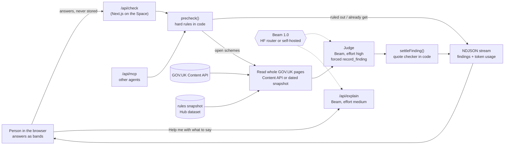

# Beacon

**Find the support that's already yours.**

This page is for anyone trying Beacon, judging it, or running it for their own residents or clients (councils, charities, advisers).

Beacon is a private benefits finder for the UK. You answer a few short questions (bands only, never your name or exact amounts), and Beacon reads the official GOV.UK rules for ten kinds of support, from Pension Credit to Healthy Start. For each one it tells you in plain words whether it is **Likely**, **Worth checking** or **Unlikely right now**, shows the exact line from the official page that the answer rests on, and tells you the next step: who to call, what to say, where to apply. It runs on Beam, Reflection AI's open model, so a council or charity can run the whole thing on its own servers and keep residents' answers in-house.

An estimated £24.1bn of income-related benefits and social tariffs goes unclaimed in Great Britain in 2025/26, across more than 7 million households ([Policy in Practice, Missing Out 2025](https://policyinpractice.co.uk/publication/missing-out-2025)). Most people miss out because they don't know, the rules are hard to read, or they feel awkward asking. Beacon takes on the first two and is gentle about the third.

### A sample check (made up, not a real person)

Margaret was born in 1952. She lives alone in a council flat in Brent, her State Pension is her only income, she has a little in savings, and her knees make stairs hard. She has never claimed anything because she assumed "it's not for people like me".

She answers a short set of questions. Beacon skips the ones that can't change anything for her (work, pregnancy, her birth month) and says why. Code settles the hard rules first: Universal Credit and Healthy Start are not for her age, and the free TV licence starts at 75. Then Beam reads the Pension Credit, Housing Benefit, Council Tax Reduction, Attendance Allowance and Warm Home Discount pages in full and records a finding for each. The rules point to Pension Credit as Likely for her, so she should see it at the top, with the GOV.UK sentence about State Pension age and weekly income quoted underneath, the claim line number, and a note that Pension Credit can open the door to help with rent, council tax and her energy bill.

## How Beam is used

Beam does the reading and judging. Code does everything that can be settled without judgement, and has the last word on every answer.

| Step | What happens | Beam reasoning effort |
| --- | --- | --- |
| 1. Pre-check | Code settles hard rules from the answers (age lines, nation, savings caps, benefits you already get). No model call. | none |
| 2. Read | Each open scheme's GOV.UK pages go into the context **whole**, every guide part in one read. Beam's 1M-token window means no chunking, no retrieval, no missed exception three parts down. | - |
| 3. Judge | Beam must answer through a **forced tool call**, `record_finding`: verdict, a one-line reason, the exact quoted rule line, the answers it relied on, and what's missing. | **high** |
| 4. Verify | **Code, not the model**, checks the quote is really on the page (`verifyQuote`, after folding spaces, curly quotes and dashes). No verified quote, no Likely: code downgrades it to Worth checking. | none |
| 5. Explain (on request) | On a result, "Help me with what to say" asks Beam for next steps and a call script or letter, from the scheme's official claim details only (`/api/explain`). | **medium** |
| 6. Explain my letter (`/letter`) | Paste a letter; code removes NI numbers, sort codes and account numbers, then Beam says what it means, what to do and by when, how to disagree, and common scam signs. Nothing is stored. | **medium** |

- **Effort where it pays.** Choosing what to read is done in code, for free. Judging the rules is where mistakes cost people money, so that step runs at high effort and writing help runs at medium. Every model step reports its tokens, and the result screen has a token meter ("How Beacon worked this out") that shows the input and output tokens per step and effort level.
- **Tools, not free text.** Findings only reach the person through `record_finding` and `settleFinding`, so the shape is fixed and the verdict can be checked. The same tools are offered to other agents over MCP at `/api/mcp` (`list_schemes`, `get_rules`, `check_eligibility`).
- **Long context instead of retrieval.** Rule pages are read whole, which is what makes the quote checker fair: the line Beam quotes has to exist in exactly what it read.
- **Open, so it can be private.** The model client is OpenAI-compatible and the endpoint and model name come from environment variables. Point it at the Hugging Face router (default), a provider directly, or your own vLLM server running Beam's open weights. Nothing else changes.

## Architecture



More detail, including the stream contract and what lives where: [docs/architecture.md](docs/architecture.md). Decisions: [docs/adr/](docs/adr/).

## Privacy

- **Nothing is stored.** An anonymous check keeps your answers in your browser only (page state and the link fragment, which browsers never send to the server). The server holds them for the length of the check and then forgets them.
- **Bands, not numbers.** Income is "under, around or well over the official line", savings are cut at the rule edges (£6,000, £10,000, £16,000). Beacon never asks for your name, full address, National Insurance number, bank details, exact amounts or full date of birth. Birth year is enough, and the month is asked only for people born in 1960 or 1961, where State Pension age depends on it.
- **Questions you can skip.** Every money question has "I'd rather not say". Beacon then says Worth checking instead of guessing.
- **Traces without inputs.** Optional LangSmith tracing never logs the answers.
- **Self-hostable.** Run it with your own Beam and nothing leaves your servers except reads of public GOV.UK pages.

## Accuracy

Beacon is measured on **BenefitsBench**, 30 made-up situations (no real people) with the verdict the official rules give for each of the ten schemes, written from the rules and not from Beacon's output. It covers people over and under State Pension age, mixed-age couples, the Pension Credit passport, Universal Credit, carers, Healthy Start, Scotland and Northern Ireland, savings edges and the Winter Fuel cut-off. Dataset and card: [`packages/evals/`](packages/evals/), published on the Hub as `beacon-benefitsbench`.

**Code-settled half (no model).** Of the 300 judgements in the set, 189 are settled by code (ruled out, or "you already get this") and 111 are left for Beam. `precheck()` is checked against all of them on every commit: 189 of 189 agree, and every open one stays open for Beam. The live numbers are on the app's [How Beacon is checked](/transparency) page.

**Beam half.** Filled in from `packages/evals/results/summary.md` after a real run. No numbers are written here until they have been measured.

| Effort (judge step) | Accuracy, all schemes | Accuracy, Beam-judged schemes | Avg tokens per check | Quote verified |
| --- | --- | --- | --- | --- |
| low | run `pnpm eval` | run `pnpm eval` | run `pnpm eval` | run `pnpm eval` |
| medium | run `pnpm eval` | run `pnpm eval` | run `pnpm eval` | run `pnpm eval` |
| high | run `pnpm eval` | run `pnpm eval` | run `pnpm eval` | run `pnpm eval` |

A verdict counts as right when it is the expected one or one a careful adviser would also accept from the same answers (for example Likely or Worth checking when a deciding question has not been asked yet).

## Limits

- **Not advice.** Beacon says what the official rules suggest. The service that runs each scheme makes the decision. Every card links to the official page.
- **Ten schemes, mostly England.** Scotland and Northern Ireland run their own versions of several schemes; Beacon says so and points to them rather than judging them.
- **Bands are blunt.** Answers near a line come back as Worth checking. That's on purpose.
- **Amounts are not calculated.** Beacon never states a figure the rule page doesn't state.
- **Rules change.** Money lines live in one config file with their sources and are uprated each April. The snapshot date is shown with every result.
- **English only for now.** Beam is mainly an English model.
- **Council Tax Reduction differs by council.** The working-age example uses Brent's scheme.

## Run it yourself

You need Node 22.18 or newer and pnpm 12 (`corepack enable` sets it up).

```bash
pnpm install
cp apps/web/.env.example apps/web/.env.local   # then fill in the values
pnpm dev                                        # http://localhost:7860
```

The model settings live in `apps/web/.env.example` (names only, never commit values):

- `HF_TOKEN` - a Hugging Face token with Inference Providers access. With only this set, Beacon uses the HF router and `reflection/Beam-1.0-501B-A23B`.
- `BEAM_BASE_URL`, `BEAM_MODEL`, `BEAM_API_KEY` - point Beacon at any OpenAI-compatible endpoint instead, such as your own vLLM server running Beam's open weights (`vllm serve reflection/Beam-1.0-501B-A23B --tensor-parallel-size 16`) or a provider's endpoint.

### On a Hugging Face Space

Duplicate the Space, add `HF_TOKEN` as a secret, and it builds from the `Dockerfile`: it installs, refreshes the rules snapshot from GOV.UK (keeping the committed one if GOV.UK can't be reached), builds the web app and serves it on port 7860 as user 1000.

### With Docker anywhere else

```bash
docker build -t beacon .
docker run -p 7860:7860 -e HF_TOKEN beacon
```

## Local development

| Task | Command |
| --- | --- |
| Install | `pnpm install` |
| Dev server | `pnpm dev` (http://localhost:7860) |
| Build | `pnpm build` |
| Lint / format | `pnpm lint` / `pnpm format` |
| Type-check | `pnpm typecheck` |
| Tests | `pnpm test` |
| Refresh the rules snapshot | `pnpm snapshot` |
| Run BenefitsBench on Beam | `pnpm eval` (needs `HF_TOKEN`; `--effort low,high`, `--cases id,id`, `--limit 5`) |

Layout: `apps/web` (the Next.js app, `/api/check` and `/api/mcp`), `packages/rules` (questions, schemes, age lines, pre-check, quote checker, GOV.UK reader, snapshot), `packages/brain` (the agent on Beam), `packages/evals` (BenefitsBench).

## Hub artefacts

- **Space:** this app.
- **Dataset `beacon-benefitsbench`:** the 30 situations, expected verdicts and Beam results per effort level ([card](packages/evals/hub/README.md)).
- **Dataset `beacon-uk-rules-snapshot`:** the exact GOV.UK text Beam read, dated ([card](packages/rules/snapshot/README.md)).

## Licence

Apache 2.0, the same as Beam. See [LICENSE](LICENSE).
