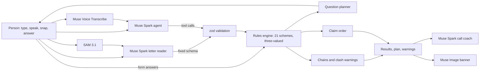

# Beacon on Meta's Muse models

**Find the support that's already yours.**

This page is for judges of the Meta Global AI Developer Hackathon (Startup track, "Build for Your World") and for anyone who wants to run Beacon.

About £24.1bn a year of income-related benefits and social tariffs goes unclaimed in Great Britain ([Policy in Practice, Missing Out 2025](https://policyinpractice.co.uk/publication/missing-out-2025)). Most people miss out because they don't know what exists, the rules are hard to read, or they're checking for a parent and don't know where to start.

Beacon is a chat. You tell it about your life, or the life of someone you look after, by typing, speaking or snapping a photo of a letter. It asks one small question at a time, only when the answer could still change something. As you answer, results light up: what's likely yours, what's worth checking, and what unlocks once a first claim is awarded. It warns you when one claim could lower another, puts your claims in the right order, and gives you the number to call and notes on what to say.

## How Meta's models are used

Each model has one job. Plain code makes every decision, so the same answers always give the same result.

| Model | ID | What it does in Beacon |
| --- | --- | --- |
| Muse Spark 1.3 | `muse-spark-1.3` | The agent in the chat. It never edits the check directly: it calls tools (`set_who`, `save_details`, `check_results`, `explain_scheme`, `plan_claims`) and code validates every argument before the rules run. |
| Muse Spark 1.3, vision + structured output | `muse-spark-1.3` | The letter reader. It reads a photo of a council or DWP letter into a fixed JSON schema and can't take any action. Code checks the schema and strips anything shaped like a National Insurance number, account number or email. |
| Muse Spark 1.3, structured output | `muse-spark-1.3` | The call coach: what to say, what to have ready and what they may ask, for one scheme, from that scheme's rules and the answers those rules read. |
| Muse Voice Transcribe | `muse-voice-transcribe-1.0` | Speech to text. The browser records 16 kHz mono WAV directly, so nothing is converted on a server. |
| SAM 3.1 | `sam-3.1` | Finds the letter in the photo and outlines it, so the person sees exactly what was read. |
| Muse Image | `muse-image-1.0` | Paints a warm banner for the results. The prompt carries life areas only, never answers. |

## Architecture



- **Rules engine** (`src/engine/rules.ts`): 21 schemes stored as data. Every condition is true, false or not known yet, so a scheme can be ruled out before all its questions are asked. Screening lines live in one `LINES` object with their sources; results close to a line come back as "worth checking".
- **Question planner**: asks whichever question settles the most open schemes, and stops when nothing left could change a result.
- **Agent loop** (`src/server/agent.ts`): Chat Completions with tool calling, up to five rounds, low reasoning effort.
- **Privacy**: answers live in the browser (memory and localStorage). API routes take what they need for one request and keep nothing. Beacon never asks for a name, a National Insurance number or bank details.
- **Spend guard** (`src/server/guard.ts`): per-IP rate limit, a daily cap and same-origin checks on every model route.

## Built during the hackathon

Everything in `apps/meta` was built for this hackathon, during the build window (27 October to 4 November 2026). This repository was created on 30 October 2026. The earlier app in `apps/web` and the packages in `packages/` belong to a separate entry and aren't used by this app.

- Rules engine with 21 GOV.UK and Social Security Scotland schemes, the question planner, claim chains, clash warnings and claim order
- The chat-first workspace: Beacon's questions inside the chat, a calm canvas where results light up, and a Details panel that lists every question and shows where each saved detail came from
- The Muse Spark agent with five tools, including switching the whole check to "Check for Mum"
- Voice input with Muse Voice Transcribe, recorded straight to WAV in the browser
- Letter reading with SAM 3.1 and Muse Spark vision, with an outbound scrub, plus a made-up sample letter anyone can try from the + menu
- Results with claim plan, "Good to know" clash notes, call coach notes and a Muse Image banner
- A calm canvas: 21 tiles that light up as answers settle each scheme
- Home page and a "How it works" page

## Run it

You need Node 22 or newer and pnpm (`corepack enable`).

```bash
pnpm install
cp apps/meta/.env.example apps/meta/.env.local   # add MODEL_API_KEY from https://dev.meta.ai/platform
pnpm --filter meta dev                            # http://localhost:3100
```

Without a key, the questions, rules and results still work; the chat, voice, letter, call notes and banner say so calmly.

## Limits

- Not advice. The organisation that runs each scheme decides, and every result links to its official page.
- Income lines are screening estimates for one adult, not the official calculation.
- Postcode to nation uses the first letters only. Council-level schemes vary.
- English only for now.
