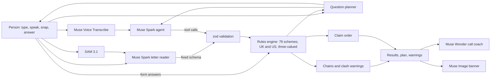

# Beacon on Meta's Muse models

**Find the support that's already yours.**

This page is for judges of the Meta Global AI Developer Hackathon (Startup track, "Build for Your World") and for anyone who wants to run Beacon.

About £24.1bn a year of income-related benefits and social tariffs goes unclaimed in Great Britain ([Policy in Practice, Missing Out 2025](https://policyinpractice.co.uk/publication/missing-out-2025)). In the US, the IRS estimates about 1 in 5 people who could get the Earned Income Tax Credit don't claim it ([Taxpayer Advocate Service, 2026](https://www.taxpayeradvocate.irs.gov/news/nta-blog/eitc-awareness-day-is-january-23/2026/01)). Most people miss out because they don't know what exists, the rules are hard to read, or they're checking for a parent and don't know where to start.

Beacon is a chat. You tell it about your life, or the life of someone you look after, by typing, speaking or snapping a photo of a letter. It asks one small question at a time, only when the answer could still change something. As you answer, results light up: what's likely yours, what's worth checking, and what unlocks once a first claim is awarded. It warns you when one claim could lower another, puts your claims in the right order, and gives you the number to call and notes on what to say.

## How Meta's models are used

Each model has one job. Plain code makes every decision, so the same answers always give the same result.

| Model | ID | What it does in Beacon |
| --- | --- | --- |
| Muse Spark 1.3 | `muse-spark-1.3` | The agent in the chat. It never edits the check directly: it calls tools (`set_who`, `save_details`, `check_results`, `explain_scheme`, `plan_claims`) and code validates every argument before the rules run. |
| Muse Spark 1.3, vision + structured output | `muse-spark-1.3` | The letter reader. It reads a photo of a council or DWP letter into a fixed JSON schema and can't take any action. Code checks the schema and strips anything shaped like a National Insurance number, account number or email. |
| Muse Wonder | `muse-wonder-1.0` | The call coach: what to say, what to have ready and what they may ask, for one scheme, from that scheme's rules and the answers those rules read. Falls back to Muse Spark if Wonder is unavailable. |
| Muse Spark Open (open weights) on Baseten, Muse Glimmer on Fireworks | `meta-models/muse-spark-open-1026`, `accounts/fireworks/models/muse-glimmer-30b` | The privacy step: every message is rewritten without names, numbers, addresses or emails before it reaches the hosted API. Hosts are tried in order, and the same rules run again as code on the output, so nothing personal leaves even if every host is down. |
| Muse Voice Transcribe | `muse-voice-transcribe-1.0` | Speech to text. The browser records 16 kHz mono WAV directly, so nothing is converted on a server. |
| SAM 3.1 | `sam-3.1` | Finds the letter in the photo and outlines it, so the person sees exactly what was read. |
| Muse Image | `muse-image-1.0` | Paints a warm banner for the results. The prompt carries life areas only, never answers. |

## Architecture



- **Rules engine** (`src/engine/rules.ts`): 79 schemes in 11 rule packs (51 UK, 28 US), stored as data. Every condition is true, false or not known yet, so a scheme can be ruled out before all its questions are asked. Screening lines live in one `LINES` object with their sources; results close to a line come back as "worth checking".
- **Question planner**: asks whichever question settles the most open schemes, and stops when nothing left could change a result.
- **Agent loop** (`src/server/agent.ts`): Chat Completions with tool calling, up to five rounds, low reasoning effort.
- **Privacy**: answers live in the browser (memory and localStorage). API routes take what they need for one request and keep nothing. Beacon never asks for a name, a National Insurance number or bank details.
- **Spend guard** (`src/server/guard.ts`): per-IP rate limit, a daily cap and same-origin checks on every model route.

## Built to scale

The check itself runs in the browser, rules live in versioned data packs (one per group of help), model answers are cached and prompt-cached, a daily job watches the official pages behind every rule, and a background pipeline harvests, triages and drafts new schemes with Muse Spark. Full principles: [docs/ARCHITECTURE.md](docs/ARCHITECTURE.md). What Beacon covers and connects to: [catalog/README.md](catalog/README.md). 

## Built during the hackathon

Everything in `apps/meta` was built for this hackathon, during the build window (27 October to 4 November 2026). This repository was created on 30 October 2026. The earlier app in `apps/web` and the packages in `packages/` belong to a separate entry and aren't used by this app.

- Rules engine with 79 schemes in 11 rule packs: 51 in the UK (DWP, councils, NHS, energy and broadband, families, Scotland, work and care, household and debt, unclaimed money, charity grants) and 28 in the US (SNAP, Medicaid, SSI, WIC, school meals, CHIP, Lifeline, LIHEAP, EITC, Child Tax Credit, Section 8, VA and more, with the 2026 HHS poverty guidelines), plus the question planner, claim chains, clash warnings and claim order
- Two countries: the country comes from the browser's languages until the person chooses one; postcode (postcodes.io) or ZIP code (zippopotam.us and the FCC area API) sets nation, council, state and county
- Real local data, matched to where you live: 7,165 council service pages (GOV.UK Local Links Manager), 12,231 grant-giving charities (Charity Commission register), 13,275 US community health centres (HRSA), 3,774 housing agencies and 1,286 housing counsellors (HUD)
- Seven languages (English, Welsh, Polish, Spanish, Bengali, Urdu, Arabic, with right-to-left layout) and a Display panel with eight comfort presets by need (easier to read, clearer colours, bigger and bolder, listen to it, calmer, fewer distractions, simple words, easier to tap); the agent replies in the chosen language and in simple words when asked
- The chat-first workspace: Beacon's questions inside the chat, a calm canvas where results light up, and a Details panel that lists every question and shows where each saved detail came from
- The Muse Spark agent with five tools, including switching the whole check to "Check for Mum"
- Voice input with Muse Voice Transcribe, recorded straight to WAV in the browser
- Letter reading with SAM 3.1 and Muse Spark vision, with an outbound scrub, plus a made-up sample letter anyone can try from the + menu
- Results with claim plan, "Good to know" clash notes, call coach notes and a Muse Image banner
- A calm canvas: one row of dots per area of life that lights up as answers settle each scheme, so it stays calm with hundreds
- Claim tracking (applied, awarded, refused) with challenge routes, awards that reopen the help they unlock, and a "new for you" note when the rules grow
- A knowledge pipeline: GOV.UK harvest (1,279 pages stored once), Muse Spark triage (300 pages of help tagged to the Beacon Framework) and Muse Spark drafts checked by the live schema
- Agent steps streamed to the chat as they happen
- Rule packs as data (`packs/*.json`, checked with `node scripts/check-packs.ts`), one answers schema, answer cache, prompt cache keys, daily knowledge watch, weekly harvest, health endpoint
- Home page and a "How it works" page that follow the person's country: a tabbed product window (chat, results, plan, call notes, near you) built from the live rule packs, and a WebGL light effect behind the hero

## Run it

You need Node 22 or newer and pnpm (`corepack enable`).

```bash
pnpm install
cp apps/meta/.env.example apps/meta/.env.local   # add MODEL_API_KEY from https://dev.meta.ai/platform
pnpm --filter meta dev                            # http://localhost:3100
```

Without a key, the questions, rules and results still work; the chat, voice, letter, call notes and banner say so calmly.

## Limits

- Not advice. The organisation that runs each scheme decides, and every result links to its official page.
- Income lines are screening estimates for one adult, not the official calculation.
- Council and state schemes vary; Beacon links to the person's own council or state office rather than guessing their local rules.
- Translations other than English were drafted with help and checked for completeness, not by native reviewers yet.
